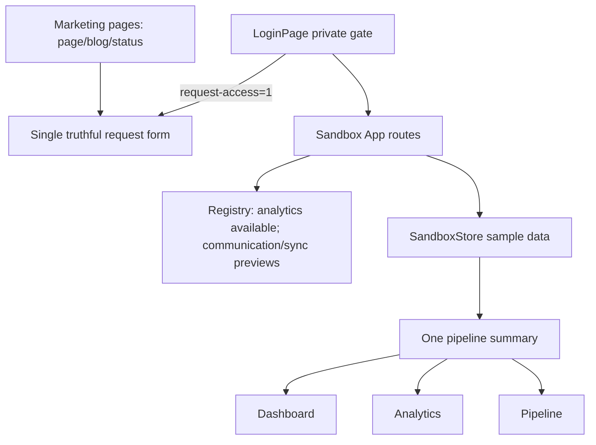

# Live audit fixes — 6 November 2026

Authorized scope: user's “fix it” approves remediation of DESIGN-IS-2026-11-06. Work in RCM at baseline 8765990, matching recent deployed Antigravity changes. No push/deployment in this phase. Existing cleanup plan remains historical context.

## Discovery and impact

Graph rebuilt locally; architecture/search and pre-edit impact queried. Target Home/Blog/Status/RootLayout/LoginPage/App impact: 22 direct nodes, 18 one-hop impacted nodes (15 displayed), 10 additional files. Demo impact: 28 direct nodes; broad two-hop matches include vendor/common-name noise, so bound edits by file imports and real consumers. No backend business/data changes intended. Graph does not accurately index HTML/CSS runtime URLs; inspect those directly. Existing memory recalled via skill-observations/log.md and cross-cutting-principles.md; no memory MCP exposed.

Patterns/API sources: marketing-site/src/app/page.js Home/openLeadModal/handleSubmitLead; blog/page.js Blog article data; status/page.js checkHealth; layout.js Next metadata; frontend-react/src/features/login/LoginPage.jsx via login-entry.jsx and vite.config.login.js; App.jsx HashRouter routes; SandboxStore getLeads/updateLead/moveLeadStage/addCallLog/reset; ModuleRegistry install/uninstall/events; SandboxTopRibbon call simulation. Use native dialog showModal/close/cancel with React refs/effects and cleanup; native links; existing React/router/store APIs. No new dependencies or persistent test runners/scripts.

## Architecture map

Duplication to remove: marketing nav/footer identity and request links diverge across three pages; homepage submission duplicates two POSTs and caches PII; dashboard/analytics/pipeline each calculate sample totals; preview routes share unrelated targets. Reuse simple shared components/helpers only for these established consumers.

## Phase 1 — marketing

Replace unsupported claims, company attribution, customer proof, benchmark/status numbers with accurate available/preview messaging. Preserve responsive foundations while simplifying hierarchy and consistent lime/type tokens. Specific feature anchors; honest mailto labels; page metadata; shareable article URLs/back-forward. Use accessible native dialogs and direct request query handling. One verified submission endpoint; success only on acceptance, actionable failure, no PII cache. Read actual existing backend request contract before changes; do not invent storage or duplicate sends.

Verify: marketing lint/build; local desktop/mobile routes, all article links and back/forward, all anchors, direct request query, keyboard trap/Escape/restore, required field validation, controlled success/HTTP failure/network failure. No real production submissions. Status must distinguish a limited probe from unknown overall service health and never infer historical uptime.

## Phase 2 — sandbox

Give speech and sync distinct explanatory preview routes and clear setup state, not enabled functionality. Analytics remains optional with correct disable/direct-link behavior. Derive shared totals/stages/counts from SandboxStore; remove unmeasured performance trends and misleading AI ranking. Accessible simulated call dialog, timer/disposition cleanup, explicit provider placeholder labels. Align accent/focus/reduced motion and target sizes.

Verify: scoped lint/build; one active navigation item, module toggle and reload/deep links, empty and zero-value summary, all stage totals, advance/edit/reset reconciliation, note/call persistence, cancel/Escape and focus restore, no real outbound calls or production writes.

## Phase 3 — access gate and integration

LoginPage remains an honest private gate: native sandbox links, direct https://alternatecrm.com/?request-access=1 link, available CRM description and explicit communication placeholders; remove unverified security/uptime/SOC2/zero-loss claims. Shared lime styling, main/skip/focus/motion. Verify frontend rewrites and rebuild login/demo assets from source with existing Vite configs; do not retain old claim-filled bundles where generated files are tracked.

Verify: build login plus demo output into frontend, target HTML metadata, local links/assets and /demo alias; no removed branding/identity/absolute claims in changed sources and regenerated public output.

## Final review

Run scoped lint, both production builds, graph update/detect-changes and simplicity review. Exercise desktop and 320/390/768 mobile, keyboard dialogs, direct routes, browser navigation, demo operations and reset. Record measured results and any true blockers. No deployment, production contact submission, mailbox claims or unverified full WCAG/performance sign-off. No broad unrelated backend cleanup. Keep audit notes and verification evidence separate from application code.
